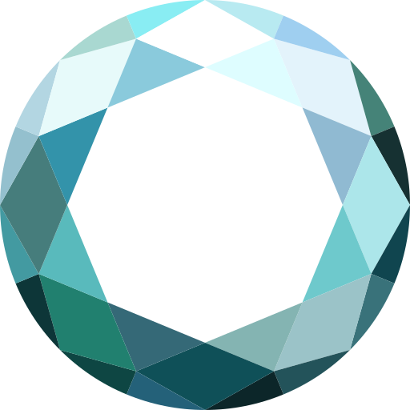
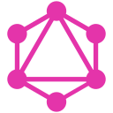

<h1>
  <picture>
    <source media="(prefers-reduced-motion: reduce)" srcset="images/jovi-avatar.png">
    
  </picture>
  João Victor
</h1>

**Software engineer · Elixir & Phoenix**

🇧🇷 Brazil · GMT -03:00 · Open to remote Elixir opportunities.

[Portfolio](https://ojoaovsousa.pages.dev/en/) · [LinkedIn](https://www.linkedin.com/in/jovi47/) · [Email](mailto:ojoaovsousa@gmail.com)

I'm a software engineer from Brazil with **5+ years of experience**. **Elixir** is my main language, usually alongside Phoenix and PostgreSQL. I enjoy turning ideas into useful systems and seeing them become part of someone's day.

Outside coding, I enjoy building LEGO and exploring interactive 3D experiences. I'm also curious about applied AI, RAG and agents, and I like learning by making things.

## A few things I've built

- [<picture><source media="(prefers-color-scheme: dark)" srcset="images/asc-symbol-dark.svg"></picture>](https://andreasousaconsultoria.com.br) **ASC-Hub** — an Elixir/Phoenix platform for clients, contracts, documents and day-to-day operations.
- [<picture><source media="(prefers-color-scheme: dark)" srcset="images/horagora-logo-dark.svg"></picture>](https://horagora.com.br) — scheduling software for barbershops, salons and studios.
- [<picture><source media="(prefers-color-scheme: dark)" srcset="images/portfolio-wordmark-dark.svg"></picture>](https://ojoaovsousa.pages.dev/en/) — a LEGO-inspired 3D world for exploring my projects and ideas.

## Technologies I use

Animated technologies · hide/show

<picture>
  <source media="(prefers-color-scheme: dark)" srcset="images/technologies-dark.svg?v=percent-width">
  
</picture>

All technologies (static list)

  <picture></picture>&nbsp;Elixir&nbsp;&nbsp;
  <picture></picture>&nbsp;Phoenix&nbsp;&nbsp;
  <picture></picture>&nbsp;LiveView&nbsp;&nbsp;
  <picture></picture>&nbsp;Ecto&nbsp;&nbsp;
  <picture></picture>&nbsp;Oban&nbsp;&nbsp;
  <picture></picture>&nbsp;PostgreSQL&nbsp;&nbsp;

  <picture></picture>&nbsp;Java&nbsp;&nbsp;
  <picture></picture>&nbsp;Spring&nbsp;Boot&nbsp;&nbsp;
  <picture></picture>&nbsp;JavaScript&nbsp;&nbsp;
  <picture></picture>&nbsp;TypeScript&nbsp;&nbsp;
  <picture></picture>&nbsp;React&nbsp;&nbsp;
  <picture></picture>&nbsp;Next.js&nbsp;&nbsp;

  <picture></picture>&nbsp;Docker&nbsp;&nbsp;
  <picture></picture>&nbsp;Kubernetes&nbsp;&nbsp;
  <picture></picture>&nbsp;AWS&nbsp;&nbsp;
  <picture></picture>&nbsp;Fly.io&nbsp;&nbsp;
  <picture></picture>&nbsp;GraphQL&nbsp;&nbsp;
  <picture></picture>&nbsp;RabbitMQ&nbsp;&nbsp;

  <picture></picture>&nbsp;Python&nbsp;&nbsp;
  <picture></picture>&nbsp;MongoDB&nbsp;&nbsp;
  <picture></picture>&nbsp;MySQL&nbsp;&nbsp;
  <picture></picture>&nbsp;Git&nbsp;&nbsp;
  <picture></picture>&nbsp;HTML&nbsp;&nbsp;
  <picture></picture>&nbsp;CSS&nbsp;&nbsp;
  <picture></picture>&nbsp;RAG&nbsp;&nbsp;
  <picture></picture>&nbsp;Agents&nbsp;&nbsp;
  <picture></picture>&nbsp;3D&nbsp;&nbsp;

